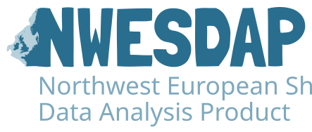

# Welcome to

A preprint describing the first version of NWESDAP is under review at *Earth System Science Data Discussions*:

!!! abstract "Citation"

    Brandon, M., Humphreys, M. P., Koek, A. C., Ádler, M. A., Bakker, D. C. E., Becker, M., Bittig, H. C., Bozec, Y., Chierici, M., Darelius, E., Findlay, H. S., Gkritzalis, T., Ivimey-Cook, R., Jones, E. M., Knockaert, M., Lange, N., Leseurre, C., Lødemel, H. H., Macovei, V. A., McGovern, E., McGrath, T., Metzl, N., O'Donnell, G., O’Sullivan, E. M., Ourradi, Y., Petton, S., Salvanes, A. G. V., Skjelvan, I., and Voynova, Y. G.: **The marine carbonate system in the northwest European shelf seas: a quality-controlled data product (NWESDAP)**, *Earth Syst. Sci. Data Discuss.* [preprint], https://doi.org/10.5194/essd-2026-872, in review, 2026.

!!! info "Funding"

    The creation of NWESDAP was funded by the [Dutch Research Council (NWO)](https://www.nwo.nl/en) through the [NoSE project](https://NoSE-NL.github.io/) (OCENW.XL21.XL21.075).
